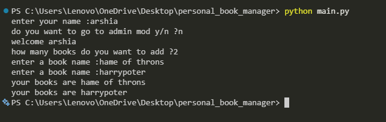
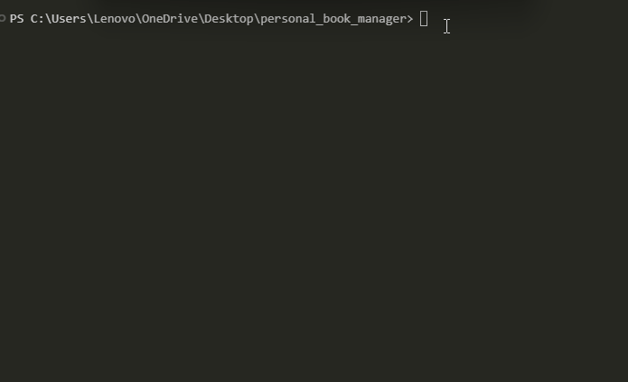

# Personal_book_manager

A simple book manager Build with Python


## Fatures

- add multiple book
- Save books
- Load save book
- Admin mod

## Project Structure

```txt
personal_book_manager/
│   .env.example
│   .gitignore
│   books.py
│   main.py
│   README.md
│   requirements.txt
├───images/
│       Animation.gif
│       screeenshot.png
```

| file               | Discribtion                                                 |
| ------------------ | ----------------------------------------------------------- |
| `.env.example`     | where we keep an exapmle of the password                    |
| `.gitignore`       | keeps the file that git have to ignore                      |
| `books.py`         | A secondary file htat kepps the functions                   |
| `main.py`          | A file that has the main codes and the books in it          |
| `README.md`        | Keeeps a short discribtion about hte whole project          |
| `requirements.txt` | The requiremrnts that are needed for the project            |
| `images/`          | The folder that keeps the images and the gifs of the README |
| `Animation.gif`    | The gif off the project                                     |
| `screeenshot.png`  | The screenshot for the README                               |

## Requirments

- Python
- Python-dotenv

## How it works

1. Enter your name
2. Say if you want the admin mood y/n
3. choose how many books you want to add
4. Enter the books name

## Troubleshootin

- FileNotFoundError
  - when the books.json is not found
- json.decoder.JSONDecodeError
  - whent books.json is epmty
- Python-env
  - If you haven't donloaded the Python-env librarry
- .env
  - make sure to use the .env ass the file taht kepps the password not the .env.exapmle

## Installation

Install the `requirements.txt` packahes

```bash
python -m pip install -r requirements.txt
```

## Envoirment setup

create a `.env` file in the project folder

Use `.env.example` file as a template

Add your admin password

```env
BOOK_MANAGER_PASSWORD = YOUR_PASSWORD_HERE
```

Replace `BOOK_MANAGER_PASSWORD = YOUR_PASSWORD_HERE` with your own admin password

## Run the program

run the main file

```bash
python main.py
```

## Screenshot



## Demo



# Personal_book_manager

A simple book manager Build with Python


## Fatures

- add multiple book
- Save books
- Load save book
- Admin mod

## Requirments

- Python
- Python-dotenv

## Installation

Install the `requirements.txt` packahes

```bash
python -m pip install -r requirements.txt
```

## Envoirment setup

create a `.env` file in the project folder

Use `.env.example` file as a template

Add your admin password

```env
BOOK_MANAGER_PASSWORD = YOUR_PASSWORD_HERE
```

Replace `BOOK_MANAGER_PASSWORD = YOUR_PASSWORD_HERE` with your own admin password

## Run the program

run the main file

```bash
python main.py
```

## Screenshot


